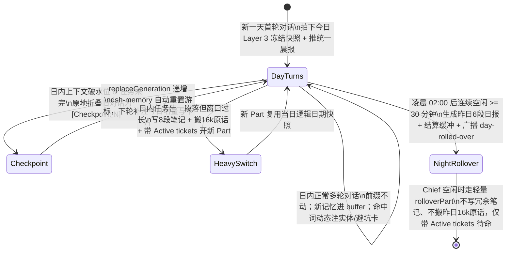

# 上下文全生命周期与检索回忆策略复盘

> 记录日期：2026-11-24  
> 适用范围：`dsh-memory` + `dsh-ctrl`（定制 `ds-bot`）联调全链路  
> 定位：彻底厘清每一轮发给大模型的上下文长什么样、怎么随时间切换，以及遇到未知信息时“先查什么、怎么查最顺手、后续怎么改最合理”。

---

## 一、 一帧模型请求里的上下文长什么样？（五层三明治结构）

当用户向主秘书 `Chief` 发出一句话时，送进大模型的上下文从上到下由 **5 层** 严格拼成（前 3 层全天锁死以吃满服务商 Prompt Prefix Cache，后 2 层仅向尾部追加）：

```text
┌──────────────────────────────────────────────────────────────────────────┐
│ Layer 1: 工具定义 Schema（全天固定）                                       │
│   DSH 基础工具 + ds-bot 团队/卡片工具 + ctrl 工单/晨报/artifact 工具         │
│   + dsh-memory 15 个 memory_* 工具参数定义                                │
├──────────────────────────────────────────────────────────────────────────┤
│ Layer 2: Bot 身份与协作规则（System Prompt · order: 640 · 全天固定）        │
│   ds-bot/src/host/prompt.js -> Chief 身份 + MAIN_RULES + TEAM_RULES       │
├──────────────────────────────────────────────────────────────────────────┤
│ Layer 3: 静态冻结记忆前缀（System Prompt · order: 645 · 当日快照字节级锁死） │
│   dsh-memory/src/context.js -> snapshots/<sessionId>__<YYYY-MM-DD>.md    │
│   1) 当前逻辑日期 + 安全隔离声明(HEADER_NOTE) + 工具引导(USAGE_GUIDANCE)    │
│   2) 核心画像 PROFILE.md（<= 2000 tokens，全量不截断）                      │
│   3) 昨日完整 6 段日报（<= 1500 tokens）                                   │
│   4) 近 7 天日报精华（<= 2000 tokens，仅留：纠正与教训 > 决定 > 悬而未决）   │
│   5) 跨月历史 L0 总览地图 history/.abstract.md（<= 1000 tokens）           │
├──────────────────────────────────────────────────────────────────────────┤
│ Layer 4: 换段开场交接包（仅在切换新 Part 后的首条历史记录出现一次）          │
│   ds-bot/src/host/parts.js -> [Handoff · part N]                         │
│   - 跨日轻量换段(dayRollover)：一句话切日说明 + ## Active tickets 活跃工单  │
│   - 日内超长/切目录换段：LLM 8段式交接笔记 + Active tickets + 近16k原话     │
├──────────────────────────────────────────────────────────────────────────┤
│ Layer 5: 滚动对话流 + pre-step 动态增量穿插（只追加不改前文，同样命中缓存）  │
│   - [每日首轮] dsh-ctrl/briefing：合并昨日亮点 + 待审缓冲 + 到期/待拍板工单  │
│   - [按需触发] dsh-memory/delta：今日新增缓冲 + 本轮命中的实体卡/避坑卡      │
│   - [每10分钟] ds-bot-time-context：精确当前时间快照                       │
│   - [真实交互] 用户消息 <-> 模型思考/工具调用（超长输出转存 artifact://<id>）│
└──────────────────────────────────────────────────────────────────────────┘
```

---

## 二、 上下文的完整生命周期（4 个关键切换节点）



1. **日内对话期（保缓存）**：白天你说“记住 X”或纠正模型，只追加进 `buffer/YYYY-MM-DD.jsonl`，**绝不改 Layer 3 快照**；若本轮提到了“服务器 A”或“nginx”，`agent/pre-step` 把对应卡片作为一条 `dsh-memory/delta` 消息插进 Layer 5，并在 `session_state` 记下“本会话已注过”，后续轮次既看得到又不重复塞。
2. **日内原地压缩（Checkpoint 防失忆）**：对话太长触发原地压缩时，DSH 的 `session.surface.replaceGeneration` 会 `+1`；`dsh-memory` 侦测到后立即清空该会话的已注游标，下一轮自动把今日缓冲区新条目和当前话题命中的卡片重新补进上下文。
3. **跨日夜间切段（零噪声换新）**：`dsh-memory` 先把昨天对话炼成不可变日报并结算缓冲区，随后通知 `dsh-ctrl` 调 `rolloverPart` 静默换到新 Part——跳过原版 `ds-bot` 的 LLM 交接摘要和 16k 旧消息搬运（因为新一天首轮渲染 Layer 3 时，昨日完整日报和新版 `PROFILE.md` 已经自动在前缀里了），只把未完结的 `## Active tickets` 带过去。
4. **工具大输出防撑爆**：超过阈值的命令日志/文件内容由 `ctrl/artifacts.js` 落盘为 `artifact://<id>`，上下文里只留摘要与句柄，按需用 `artifact_read` 分段翻阅。

---

## 三、 检索与回忆策略复盘：遇到“不知道的东西”该怎么查？

### 1. 最佳回忆与检索漏斗（由近及远、由结构化卡片到碎原文）

遇到上下文里没直接给出的信息时，最顺手、省 Token、准确率最高的查找顺序应是 **4 步漏斗**：

1. **第 0 步：先看眼前的常驻与增量区（0 工具调用，解决 ~70% 问题）**
   - 长期偏好/规矩看 `PROFILE.md`；昨天及近一周的决定/教训看冻结日报区；刚提到的实体/避坑看本轮 `dsh-memory/delta`；活跃任务看交接包里的 `Active tickets`。**已在上下文里的绝不调工具重查。**
2. **第 1 步：按问题属性第一时间分流（找准抽屉，不混查）**
   - **查“任务进度 / 卡在哪 / 刚跑出来的长日志”** ➔ 调 **`ticket_list` / `ticket_get`**，看长输出调 **`artifact_read`**（铁律：动态任务进度永远以工单账本为准，不查记忆库）；
   - **查“某人 / 某项目 / 某台机器背景”或“某类操作有什么雷区”**（因代称未触发自动注入时）➔ 优先调 **`memory_entity_manage(list/read)`** 或 **`memory_lesson_manage(list/read)`**。卡片是提炼过的高密度结论，信噪比远高于翻聊天记录。
3. **第 2 步：查“历史讨论 / 当时怎么定的 / 精确原话细节”➔ 走两路下钻**
   - **路线 A（知道大概时间，如“上周三”“上个月”）**：
     - 近两周：直接 `memory_journal_read(date)` 读当天 6 段日报；
     - 跨月远期：`memory_history_browse(month, level="L1")` 看月度概览定位日期 ➔ `memory_journal_read(date)` 拿到 `[chat://...]` 锚点 ➔ `memory_read_context(anchor, before=3, after=3)` 展开前后完整对话。
   - **路线 B（不知道时间，或查“今天早些时候上个 Part 刚聊过的细节”）**：
     - 调 **`memory_search(query="2~3个核心名词/英文词", contextTurns=1)`**（注意：`archive.sqlite` 是实时逐句入库的，**今天刚聊但未日结的原话同样能搜到**！搜索词务必用短核心实体词如 `"cloudflare tunnel"`，忌塞整句口语）；
     - 命中关键锚点但上下文不全时，再接一次 **`memory_read_context(anchor, before=3, after=5)`**。
4. **第 3 步：动手改代码/配置前的“现实核验”**
   - 记忆与日报只代表“过去某刻的事实”。从记忆查到文件路径、端口号或配置项后，执行修改前必须用 `read` / `grep` 等工作区工具核实当前磁盘现状。

---

## 四、 现状复盘发现的 8 个摩擦点与隐蔽盲区

对照上述理想漏斗与最新双仓代码，当前存在 **4 个提示词/检索摩擦点** 与 **4 个上下文/存储隐蔽盲区**：

### （一）提示词与检索体验摩擦点

1. **【指令冲突】两套原话检索工具在提示词里“左右互搏”**
   - **现状**：Layer 2（`ds-bot/src/host/prompt.js` 第 23 行）教模型“找早期原话细节调 `read_own_chat`（`[part 2 #1234]` 锚点）”；紧接着 Layer 3（`dsh-memory/src/context.js` `USAGE_GUIDANCE`）又教模型“查历史原话调 `memory_search` + `memory_read_context`（`chat://` 锚点）”。
   - **优化方案**：双插件联调时明确主次——**跨天/跨段搜个人对话统一走 `memory_search` + `memory_read_context`**，`read_own_chat` 仅降级用于查看旧 Part 的 `[Handoff]` 交接笔记或群聊上下文，避免模型选工具纠结。
2. **【引导平铺】`USAGE_GUIDANCE` 是“工具说明书”而非“决策路由表”**
   - **现状**：`dsh-memory/src/context.js` 把 15 个工具按功能罗列了一遍，但没告诉模型**先后顺序**和**短词搜索技巧**。
   - **优化方案**：将 `USAGE_GUIDANCE` 改写为 5 行紧凑的“按意图查表（先看前缀 ➔ 查人/坑先翻 Entity/Lesson ➔ 查日期走 History/Journal ➔ 查原话用短核心词 `memory_search` + `memory_read_context`）”。
3. **【工具面过宽】15 个记忆工具全量常驻主会话 Layer 1**
   - **现状**：像 `memory_dream_now`、`memory_digest_now`、`memory_rollback`、`memory_onboarding` 这类低频运维/一次性工具每轮都占着 Chief 的工具 Schema 预算和注意力。
   - **优化方案**：日常对话只向模型常驻暴露高频核心工具（检索 4 个 + 缓冲写入/确认 + 实体/避坑查看 + 遗忘），低频运维操作收口到设置面板或合并为单一管理入口。
4. **【场景无区分】闲聊与工作共享同一套冻结日报与卡片触发**
   - **现状**：冻结前缀永远挂着近 7 天开发日报，聊生活话题时容易把模型带偏去提旧项目。
   - **优化方案**：对应 `dsh-memory` Issue `#9` 第 2 项，引入 `work / chat` 模式与完结卡片 `status: archived` 静默归档，让上下文不仅“记得住”，还懂得“不合时宜时闭嘴”。

### （二）代码级上下文与存储隐蔽盲区

5. **【高危 · Worker 污染与烧钱】隔离 Worker 会被默认塞入 ~6.5k 个人记忆冻结前缀**
   - **根因**：`dsh-memory/src/context.js` 的 `sectionFor` 在装配 Layer 3 静态前缀时，仅检查了 `effectiveMode(sessionId) === 'off'`，**未过滤 `session.header.origin === 'subagent'` 或 `worker-*` 会话**（`isSubagent` 目前只在 `pre-step` 中拦了晨报/冷启动，没拦 System Prompt）。
   - **后果**：`dsh-ctrl` 拉起一次性 `worker-<ticketId>` 时，每个后台 Worker 都会白白背上几千 Tokens 的个人画像与近 7 天闲聊日报，破坏“干净装配”并翻倍消耗费用。
   - **解法**：`dsh-memory` 默认对 `subagent` 会话跳过静态前缀注入（或增加配置项 `ingest.injectSubagentPrefix: false`），同时 `worker-executor.js` 创建 Worker 会话时显式将其设为无痕/仅靠 `memoryBridge.matchEntities / matchLessons` 按需喂卡。
6. **【检索死角】`memory_search` 漏搜了 `entities/*.md` 与 `lessons/*.md` 正文**
   - **根因**：`dsh-memory/src/tools.js` 的 `memory_search` 目前只检索 `archive.sqlite`（对话原文）与 `journals/*.md`（日报），**完全没有扫描实体卡与避坑卡的正文**。
   - **后果**：若用户按卡片内部细节反查（如问“哪台机器用了 `15432` 端口？”，未提及机器名因此不触发别名动态注入，且该条目系手写或早期原文已清理），`memory_search("15432")` 会直接报未命中。
   - **解法**：卡片总量极小，在 `memory_search` 中顺带扫描 `entities/` 与 `lessons/` 正文并归入 `Card Matches` 分组返回（耗时 `< 2ms`），彻底消除检索死角。
7. **【换段断片】日内重型换 Part 时，上一轮刚触发的实体/避坑卡语境会丢失**
   - **根因**：`ds-bot/src/host/parts.js` 的 `historyEntry` 在向新 Part 搬运最近 16k 原话时，只保留 `source.kind === 'user'`，会自动剥离上个 Part 动态插入的 `dsh-memory/delta` 卡片消息。
   - **后果**：上个 Part 刚聊完“服务器 A”便触发日内换段，用户紧接着用代词提问（如“去看看**它**的日志”），新 Part 既未继承旧卡片、新消息里又不含实体别名，导致模型瞬间“断片”。
   - **解法**：日内换段时从搬运的 `recent` 原话中做一次轻量 `matchEntities / matchLessons` 预热注入，或在交接笔记中保留当前活跃实体名。
8. **【磁盘与隐私】`artifacts/` 缺过期回收（GC）与主动遗忘联动**
   - **根因**：`ds-bot/src/host/ctrl/artifacts.js` 将所有 `> 12,000` 字符的工具输出持久化为 `~/.dsh/bot/artifacts/art-*.txt`，当前尚无 TTL 清理机制。
   - **后果**：① 未绑定到任何 `Ticket.artifacts` 的临时工具输出（如随手 `cat` 大日志）长期累积会产生大量碎文件；② 用户调用 `memory_forget` 删除某段含敏感输出的历史时，`dsh-memory` 清理了 9 层但 `art-*.txt` 仍留在磁盘。
   - **解法**：为未关联工单的临时 Artifact 增加默认 7–14 天空闲 GC，并提供按会话/时间窗口清理孤立 Artifact 的钩子。

---

## 五、 双仓 Issue 归口建议（按仓库边界拆分执行）

遵循 `dsh-ctrl/docs/SPEC.md` 规范，后续动刀时按仓库拆分为两张独立 Issue 推进：

- **`5quan/dsh-memory`（归入 Issue `#9` 或拆子单）**：负责上述第 **2、3、4、5（`subagent` 前缀策略）、6（`memory_search` 补扫卡片正文）** 项，以及修复 `src/dream.js` 日报 1800 字头部截断隐患。
- **`5quan/dsh-ctrl`（新建上下文与生命周期对齐 Issue）**：负责上述第 **1（收敛 `read_own_chat` 与 `memory_search` 提示词冲突）、5（Worker 侧显式隔离记忆模式）、7（日内换段实体预热）、8（`artifacts` TTL 回收与遗忘清理）** 项。
