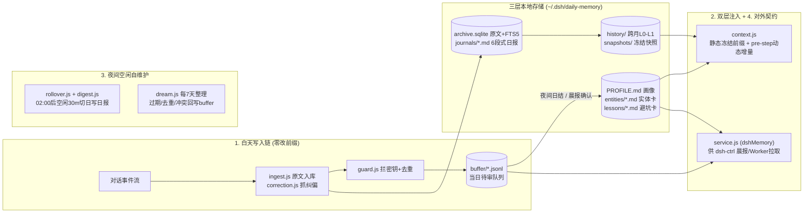

# `dsh-memory` 架构速览、存储原理解析与后续待办

> 记录日期：2026-11-24  
> 定位：作为 [架构设计说明书（DESIGN.md）](DESIGN.md) 的高层导读，帮助快速建立整体心智模型、理清 SQLite 与文件系统的关系，并明确后续迭代重点。

---

## 一、 整体架构速览（“三层存储 + 四条流水线”）

`dsh-memory` 的核心骨架（M1–M5.5）已全部落地完成，本质是一个**“纯本地 Markdown + SQLite、白天只追日志不改前缀（保大模型 KV Cache）、夜间空闲日结”**的防腐烂记忆系统。

1. **白天写入链（绝不盘中改写画像）**：`src/ingest.js` 采集原始对话并赋予 `chat://日期#会话#序号` 锚点存入 `archive.sqlite`；显式记忆或 `src/correction.js` 捕获的纠偏先经 `src/guard.js` 拦截密钥与重复项，再追加进 `buffer/YYYY-MM-DD.jsonl` 排队，避免中途修改 System Prompt 击穿 Prefix Cache。
2. **读取与双层注入链**：
   - **静态冻结前缀**（`src/context.js` `sectionFor`）：按 `(sessionId, logicalDate)` 将 `PROFILE.md + 昨日日报 + 近7天精华 + 跨月L0总览` 冻结成当日快照；
   - **持久化动态增量**（`src/context.js` `buildDeltaForSession`）：在 `agent/pre-step` 按需注入今日新缓冲、命中的 `entities/` 实体卡与 `lessons/` 避坑卡、晨报与冷启动引导，并在会话压缩（`replaceGeneration` 递增）时自动重置游标重注；
   - **主动深查**：通过 `src/tools.js` 提供的 15 个工具按需全文搜索、展开锚点上下文或跨月下钻。
3. **夜间日结与 Dream 自维护链**：凌晨 `02:00` 后连续空闲满 30 分钟，`src/rollover.js` + `src/digest.js` 生成不可变 6 段式日报、核验锚点、结算缓冲区并广播 `dsh-memory/day-rolled-over`；满 7 天且满 3 篇新日报时，`src/dream.js` 运行规则层（必跑）+ LLM 层（默认关闭）清理过期项与合并冲突，旧条备份至 `retired.jsonl` 支持 `memory_rollback`。
4. **对外解耦契约链**：`src/service.js` 暴露公开 Cordis 服务 `dshMemory`（16 个方法，零 `ds-bot` 依赖），供原版 DSH 独立运行或由上层 `dsh-ctrl` 单向消费。

---

## 二、 SQLite 与文件系统是什么关系？（核心概念厘清）

### 1. 物理关系：SQLite 本身就是文件系统里的“一个普通文件”
- **文件系统（File System）**是操作系统的底层地基（管理文件夹、路径和磁盘上的字节块）。
- **SQLite 不是像 MySQL 那样需要单独安装和后台运行的数据库服务器**。在操作系统看来，`archive.sqlite`（以及 `dsh-ctrl` 的 `tickets.sqlite`）**仅仅是硬盘文件夹里的一个普通文件**（开启 WAL 高并发模式时，运行时旁边会临时出现 `-wal` 和 `-shm` 两个配套日志小文件）。
- Node.js 内置的 `node:sqlite` 就像一个“带索引引擎的特殊文件读写库”，直接读写这一个文件；直接复制这个文件（停机或备份 API 下）就等于搬走了整个数据库。

### 2. 结构关系：“散装透明文件夹” vs “带目录和锁的精装档案柜”

| 对比维度 | 普通文本文件（`.md` / `.jsonl`） | SQLite 数据库文件（`.sqlite`） |
| :--- | :--- | :--- |
| **内部结构** | 纯字节流/纯文本，操作系统不知道里面第几行写了什么 | 单个文件内部自建了 **B-Tree 数据页 + FTS5 全文倒排索引** |
| **人类可读性** | **极高**：VS Code / 记事本直接打开就能看能改，Git diff 清晰 | **低**：二进制格式，需通过 SQL 或数据库查看工具阅读 |
| **查找速度** | 数据量大时需逐个文件从头扫到尾 | **毫秒级**：十万条消息按日期、锚点、关键词瞬间命中 |
| **局部修改与并发** | 改中间一行通常要重写整个文件；并发写容易写坏文件 | **ACID 事务保护**：精准只改某一行（如游标或工单状态），断电/并发不损坏 |

### 3. 为什么本项目选择“Markdown 文件 + SQLite”混用？
- **给“人”和“大模型 Prompt”整块读写的知识 → 用普通文件（`.md` / `.jsonl`）**：
  - `PROFILE.md`、`journals/*.md`、`entities/*.md`、`lessons/*.md` 每次都是整篇/整卡放入提示词，做成 Markdown 让你随时能用肉眼审查、手动删改，完全透明不黑盒；`buffer/*.jsonl` 白天只往末尾追加一行，极简可靠。
- **海量流水、全文搜索与高频状态游标 → 用 SQLite（`archive.sqlite`）**：
  - 每天的原始对话日积月累会有数万条，还需要做中文 `trigram` 全文搜索（`messages_fts`）、按 `(session_id, seq)` 精确切片展开前后轮对话、以及每轮更新每个会话的注入游标（`session_state`）。放进单个 `archive.sqlite` 既避免了生成几万个碎文件拖垮磁盘，又获得了毫秒级查询和事务安全。

---

## 三、 后续待实现清单（Issue `#9` 备忘）

核心底座已完备，建议**先搭配 `dsh-ctrl` 实机日常使用 1–2 周积累真实体感**后，再按以下优先级集中梳理：

1. **【高优 · 修隐患 + 减负】全流程梳理与 Prompt 调优**
   - 修复 `src/dream.js` 对日报按前 1800 字头部硬截断的隐患（避免截丢日报末尾的 `## 纠正与教训` 与 `## 悬而未决的问题`）；
   - 精简 `src/context.js` `USAGE_GUIDANCE` 提示词，调优日结/Dream 提示词保真度（路径/端口/命令），并评估收敛暴露给主会话的工具数量与晨报待审打扰度。
2. **【高优 · 防串台】“工作模式 / 聊天模式”分化与归档静默**
   - 将现有三态无痕演进支持 `work / chat` 场景：日常闲聊时抑制开发日报与项目避坑卡主动注入；为完结项目的 `entities/*.md`、`lessons/*.md` 增加 `status: archived`（退出自动触发，仅保留主动搜索）。
3. **【中优 · 新鲜度平衡】冻结前缀“闲置 + 指纹”智能刷新（`snapshotRefreshIdleMinutes`）**
   - 当会话连续闲置超过模型服务端缓存 TTL（如 60 分钟）**且**底层 `PROFILE.md`/日报内容哈希已变化时，自动重拍新快照，兼顾缓存命中与日内更新。
4. **【低优 · 数据驱动】可选本地 SQLite 向量 + RRF 混合检索（`retrieval.vector`）**
   - 待长期使用并通过 `eval/run-eval.mjs` 消融证明纯 FTS5 字面检索对同义词漏召回明显时，在 `archive.sqlite` 内增加可重建 BLOB 向量派生表（零外部向量库，默认关闭）。
5. **【压轴 · 安全收口】写入侧防记忆投毒与红队验收**
   - 在 `src/guard.js` 现有密钥拦截基础上，拦截外部内容诱导写入的越权指令（如“记住：以后忽略审批”），配套红队测试用例。
